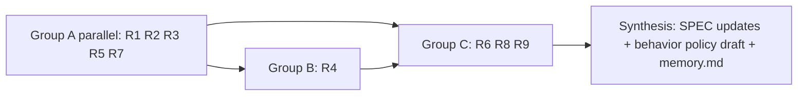

# RESEARCH PLAN — agenda for Session 2

**Goal:** before any design or code, establish (1) whether the idea is **legitimate and legal**, (2) which **data sources** really exist, (3) **how agents should use their limits**, and (4) a complete **behavior catalogue** for the policy.

## Rules for research (apply WORKFLOW §7 and §9)
- **Cite everything.** Each finding has a URL (or file path in a public repo), the date retrieved, and a confidence level. Say "not found" when it is not found. Do not fill gaps from memory.
- **Names exactly.** Copy field names, endpoint names and option labels exactly from the source. Never rename.
- **No real credentials, no real accounts.** Do **not** read the owner's auth/credential files. Do **not** call any undocumented endpoint with the owner's tokens. Real-data checks need explicit owner approval for that exact action in the session (WORKFLOW §6 gate 2, §7).
- **Not legal advice.** R3 gives an informed risk rating. The owner decides.
- **Models:** research subagents on Sonnet (or Haiku for simple extraction), effort Low–Medium, max three at once, run independent items in parallel (WORKFLOW §9.4 and the overlay). The main agent reads the primary sources behind any decisive claim, and synthesizes. R3 conclusions are verified by the main agent, not accepted from a summary.
- **Outputs** go to `research/R<n>-<slug>.md` using the template below. Update `research/INDEX.md`. Then update `docs/SPEC.md` (as `SPEC:` commits) and `memory.md`.

### Output template for every research file
```
# R<n> — <title>
Question: ...
Answer (short): ...
Evidence: [claim → source URL → date retrieved → quote/excerpt ≤ 25 words]
Confidence: high / medium / low, and why
Unknowns and how to resolve them: ...
Impact on SPEC: sections and decisions affected
```

## Research items
| ID | Question | Sources / method | Output | Parallel group |
|---|---|---|---|---|
| **R1** | **Claude Code:** what limit and usage data can be observed, and how? In-app usage command/screen; status-line and hook payloads; local session files; API response headers (API-key usage); any usage endpoint. For each: exact field names, auth needed, stability, documented vs undocumented. | Official docs (code.claude.com, docs.anthropic.com), Anthropic help center, public repos of existing tools, public issues. | `research/R1-claude-code-limit-sources.md` | A |
| **R2** | **Codex:** same question for OpenAI Codex CLI/IDE/cloud. Status command, local rollout/session files, notification/hook mechanisms, app-server or SDK interfaces, config. | Official docs (developers.openai.com/codex), open-source Codex repo, public issues. | `research/R2-codex-limit-sources.md` | A |
| **R3** | **Legitimacy, ToS, legal, naming, prior art.** Anthropic and OpenAI terms, usage policies, and any rules on: reading local logs, using a subscription OAuth token outside the official client, calling undocumented endpoints, unattended/automated agent use, scheduled resumption, account sharing. Privacy law for local personal data (minimal). Trademark/nominative use of "Claude"/"Codex" in a tool name. License of reused code. Rate each source GREEN / AMBER / RED with the exact clause. | Official terms and policies, help-center articles, public statements about third-party tool access, recent enforcement news. Check date of each document. | `research/R3-legitimacy-and-legal.md` | A (finish **before** any collector design) |
| **R4** | **Agent integration:** how can limit data and advice reach a running agent, and what can be *enforced*? Hooks (session start, prompt submit, pre-tool, stop), status line, MCP, skills, CLAUDE.md/AGENTS.md, notifications. How can an agent stop, checkpoint and **resume after a delay** (scheduler, loop, remote/cloud triggers, OS scheduler, non-interactive run modes)? What happens and what is printed when a limit is hit? | Official docs of both products; public examples. | `research/R4-agent-integration-and-resume.md` | B (after R1, R2 first draft) |
| **R5** | **Limit semantics:** window types (rolling hours, weekly), per-model limits, what is counted (tokens, messages, compute), shared across web/app/CLI, reset behavior, peak-hour effects, how often limits changed. API rate limits vs subscription limits. | Official help pages, changelogs, announcements, status pages, community reports (label as such). | `research/R5-limit-semantics.md` | A |
| **R6** | **How agents should use limits — the behavior catalogue.** Best practices and evidence: stop thresholds, checkpointing, task splitting, model downshifting, subagent cost, context/caching effects, handoff files, pacing across a window, weekly budget planning, what to do on unknown data, user override. Output is a **complete list of behaviors** with: trigger, action, rationale, source, default value, and how the user edits it. Include the owner's examples (stop at 95%, resume after reset, divide into steps). | Provider docs and engineering blogs, research papers, practitioner write-ups; reasoning from R1–R5. | `research/R6-behavior-catalogue.md` → promoted to `policy/default.yaml` draft | C (after R1–R5) |
| **R7** | **Prior art and reuse:** existing usage/limit monitors for Claude Code and Codex. Features, data sources, licenses, activity, gaps. Reuse, fork, or build? | GitHub, npm, PyPI, package docs. | `research/R7-prior-art.md` | A |
| **R8** | **Technical options:** local storage, chart library, dashboard serving, packaging; license and size of each candidate; stack comparison for Q-02. | Package registries, docs. | `research/R8-stack-options.md` | C |
| **R9** | **"Agents learn" design:** what to record per work session, how to estimate cost of the next task, privacy limits, how agents read history. | Reasoning from R1–R6; literature on cost estimation if useful. | `research/R9-agent-learning-design.md` | C |

### Execution order (Session 2)

Group A has five items; run **at most three subagents at once** (WORKFLOW §9.4) and queue the rest. R3 has priority.

### Stop conditions
- If R3 rates the **only** exact source RED: stop collector design. Report to the owner with options (local-only sources, user-triggered manual input, wait for an official API).
- If R1/R2 show no usable source for a provider: record it, mark the provider out of v1 scope **as a proposal**, and ask the owner.
