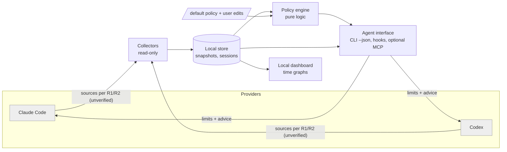

# SPEC — show-llm-limits

> **STATUS: DRAFT v0 — NOT APPROVED.** No product code may be written until the owner approves this spec (WORKFLOW §2). Statements marked **[UNVERIFIED]** are hypotheses to be checked in research (`docs/RESEARCH-PLAN.md`). Statements marked **[PROPOSAL]** are recommendations waiting for an owner decision (`docs/OPEN-QUESTIONS.md`). Nothing in this file is invented as a verified fact about a provider.
>
> Working name: `show-llm-limits` (final name: open question Q-01).

## 1. Goal (required)

**Who:** (a) AI coding agents — Claude Code and OpenAI Codex first; (b) the human who owns the subscription accounts those agents run on. The tool is **free and public**; at minimum it must work for the owner's personal use.

**Problem:** Agents work until a provider limit stops them. They do not know how much allowance is left, when it resets, or how to plan work around it. Users cannot see their consumption over time.

**What v1 does:**
1. **Show limits to agents.** An agent can ask "what are my limits now?" and get a machine-readable answer: used %, window, reset time, data freshness.
2. **Tell agents how to manage work.** A **behavior policy** converts limit state into guidance or actions. Examples from the owner: stop at 95% used; resume after the window resets (for example 5 hours later); split work into steps; checkpoint before stopping. **The user can edit every behavior.** A default policy ships with the tool.
3. **Dashboard for the user.** Graphs of limit consumption over time, per provider and window.
4. **Make history available to agents.** The same data is readable by agents, so they can learn from past work (how much allowance a kind of task consumed) and balance work against limits. The user can enable highly autonomous operation if they choose.

**Done for v1 =** items 1–4 work end-to-end for Claude Code and Codex on the owner's machine, installable by a technical user from public instructions, with tests passing and all §6 workflow gates met. **Fast and functional first. No visual design work (D-002).**

**Out of scope for v1 [PROPOSAL]:** hosted service, accounts/login, multi-user teams, billing, providers other than Claude Code and Codex, any upload of usage data off the user's machine, visual design polish, mobile apps.

## 2. Data (required)

**External data sources: not yet verified.** Per WORKFLOW §2.2 and §7, field and option names are copied exactly from real systems only after research. Until then this table lists **categories**, not field names. No field name below is a claim.

| Candidate source (category) | Provider | Why we want it | Status |
|---|---|---|---|
| Provider's own in-app usage/limit command or screen | Claude Code, Codex | Authoritative numbers shown to the user | **[UNVERIFIED]** R1, R2 |
| Local session/log files written by the agent CLI | Claude Code, Codex | Offline, no credentials needed; may carry token counts and possibly limit info | **[UNVERIFIED]** R1, R2 |
| Status-line / hook / notification payloads the CLI passes to extensions | Claude Code, Codex | Official extension points; real-time | **[UNVERIFIED]** R1, R2, R4 |
| Provider HTTP endpoints (documented or not), rate-limit response headers | Anthropic, OpenAI | Could give exact limit state; may need the user's credentials | **[UNVERIFIED]** — legal/ToS risk, R3 first |

**Hard constraints [PROPOSAL, to confirm in Q-08]:** local-first; read-only toward providers; never store or log credentials; never transmit usage data anywhere; if a source needs the user's tokens, it is **opt-in, off by default**, and allowed only if R3 finds it legitimate.

**Own data model [PROPOSAL — shape only, to refine after R1/R2]:** local store with (a) *limit snapshots* — provider, account label, window id, used %, resets-at, observed-at, source, confidence; (b) *work sessions* — agent, start/end, tokens or cost where observable, % of window consumed, outcome (completed / stopped by policy / hit limit); (c) *policy events* — which rule fired, when, what the agent was told. No message content is stored.

| Own store | App reads | App writes |
|---|---|---|
| Local database in the user's data directory | yes | yes (its own store only) |
| Provider systems | yes (per R1–R3) | **no** |
| This repository | n/a | no (data and secrets are git-ignored) |

## 3. Features (free-form)

### 3.1 Components [PROPOSAL]

*Status: proposal. No component exists yet. The interface mechanisms depend on R4.*

### 3.2 Behavior policy [PROPOSAL — starting point from the owner's examples]
A policy is data, not code, so the user can edit it. Example shape (not a final schema):
```yaml
# policy/default.yaml — illustrative only
rules:
  - id: warn
    when: { used_pct_gte: 80 }
    advise: "Finish the current step. Do not start large new tasks."
  - id: checkpoint
    when: { used_pct_gte: 90 }
    action: write_checkpoint            # save progress notes so work can resume
  - id: stop
    when: { used_pct_gte: 95 }
    action: stop_and_schedule_resume    # stop cleanly
    resume: { after: window_reset }     # e.g. about 5 hours later
  - id: unknown_data
    when: { data_age_gt: 15m }
    advise: "Limit data is stale. Treat as unknown. Do not assume there is room."
```
Behaviors the owner listed: stop at 95%; resume after reset; split work into steps; consider both the provider limits and the user's wishes. **The full behavior catalogue is written in the research session (R6)** and stored in `research/` then promoted to `policy/`.

### 3.3 Agent decision loop [PROPOSAL]
```mermaid
sequenceDiagram
  participant A as Agent
  participant T as show-llm-limits
  A->>T: status (start of task, and between steps)
  T-->>A: limits + freshness + advice from policy
  alt below thresholds
    A->>A: continue, plan steps to fit remaining allowance
  else checkpoint threshold
    A->>A: write checkpoint, finish current step only
  else stop threshold
    A->>T: record stop, request resume time
    A->>A: stop cleanly; resume after reset
  end
  A->>T: record outcome (what the task cost)
```
**Enforce vs advise** is an open technical question (R4): some hosts allow hooks that block actions; others only allow instructions the agent may ignore. The spec must say which behaviors are enforced and which are advice, per provider.

### 3.4 Dashboard [PROPOSAL]
Local web page served by the tool. Time-range selector; line/area graph of used % per provider and window; table of recent work sessions and policy events. **No design system, no polish (D-002).** Supported UI for gates 4–5: one desktop browser, one theme, two window sizes (to be confirmed in Q-12).

### 3.5 "Agents learn" — scope [PROPOSAL]
"Learn" means **retrieval of history and summaries**, not model training. Agents can read: past sessions, how much allowance each task type consumed, which rules fired, and outcomes. They may use it to estimate cost of the next task and plan steps. Whether agents may **edit the policy themselves** is an owner decision (Q-09); default proposal: **no, they may only propose edits**.

## 4. Edge cases (free-form)
- **Unknown ≠ OK.** If limit data is missing, stale or unparseable, the answer is `unknown`, and the policy decides the safe behavior. It never reports 0% by default.
- **Provider changes formats or limits without notice.** Collectors must fail loudly and say which source broke.
- **Several agents share one account.** Two agents can burn the same window at once. The tool should show combined consumption. Per-agent attribution may be partial.
- **Agent runs in the cloud (for example Claude Code on the web) or in a container** and cannot read the user's local files. Local collectors then do not work there. How to bridge this is open (Q-03, R4).
- **Several accounts or plans** (personal/work; API key vs subscription): different limit types. Account labels are needed.
- **Time zones, clock skew, DST** for reset times.
- **User and agent disagree** (policy says stop; user says continue): the user's explicit instruction wins, and the override is logged.
- **Privacy:** no message content, prompts, code or credentials in the store, logs, fixtures or screenshots.
- **Naming/trademark:** the tool is independent; it is not affiliated with Anthropic or OpenAI (R3 checks naming).

## 5. Build order (required) — DRAFT, depends on R1–R9 and Q-01…Q-14
Each step must be testable and reviewable. Order is a proposal; research may remove or reorder steps (for example if a source is not legitimate).

1. **Step 1 — Project skeleton:** language/tooling, lint, build, test commands, CI, repo layout. Check: commands run green on an empty project.
2. **Step 2 — Policy schema + engine (pure logic):** policy format, validation, evaluation, default policy v0 from R6. Check: unit tests for every rule and edge case in §4.
3. **Step 3 — Store:** local database for snapshots, sessions, policy events. Check: tests; data stays local.
4. **Step 4 — Collector: Claude Code** (source from R1/R3). Check: run against the owner's real, authorized data (gate 2) and a redacted fixture.
5. **Step 5 — Collector: Codex** (source from R2/R3). Same checks.
6. **Step 6 — Agent CLI (`status`, `advise`, `record`)** with `--json`. Check: output schema tests; an agent reads it.
7. **Step 7 — Agent integration:** hooks/instruction snippets/optional MCP per R4, for both providers. Check: a real agent session sees the limits and follows a rule.
8. **Step 8 — Dashboard v0:** graphs from the store. Check: owner opens it on the real device.
9. **Step 9 — History for agents / learning:** summaries and estimates readable by agents. Check: tests; owner reviews sample output.
10. **Step 10 — Packaging, docs, license, public release.** Check: a fresh machine can install from the README.

## 6. Workflow settings (required)
- **Playbook source/ref:** embedded copy in `docs/workflow/`; upstream `Simooo1010/claude-project-playbook` commit `e9abfefc9fa120504918e464f4bf2a7dcadf0570` (D-001; changes in `docs/workflow/ADAPTATIONS.md`).
- **Approval mode:** **Strict** (default). Owner may change it by recording a decision. The owner wants high autonomy later; propose revisiting after Step 2 (Q-10).
- **Owner:** Simooo1010 (repository owner).
- **Test device(s):** not yet recorded (Q-12).
- **Supported UI:** minimal dashboard; one desktop browser; no design system.
- **Allowed external writes:** none. This repository only, on the session branch. Providers are read-only.
- **Approved dependencies:** **none yet.** Stack and dependencies are decided in Q-02 and then recorded here, with approver and date.
- **Production merge/release:** owner approval required. No written delegation exists.
- **Project commands:** lint / build / tests: not defined yet (Step 1).
- **Design system:** none (D-002).
- **Model/effort:** WORKFLOW §9 with the project overlay (A-2). Max effort High.
- **Session model:** see `docs/SESSIONS.md`. Memory: `memory.md`.

## 7. Decision log (required)
| ID | Date | Decision | Decided by | § |
|---|---|---|---|---|
| D-001 | 2026-11-08 | Embed the playbook in this repository, adapt it for this project, and follow it in every session. Upstream pinned at `e9abfef`. | Owner | 6 |
| D-002 | 2026-11-08 | No design work now. Goal is a working, functional product as fast as possible. Dashboard is minimal. | Owner | 1, 3.4 |
| D-003 | 2026-11-08 | Intent: the tool is free for everyone; at minimum free for the owner's personal use. The license is **not yet chosen** (Q-05). | Owner | 1 |
| D-004 | 2026-11-08 | Build in linked sessions: S0 setup → S1 define details → S2 research (legitimacy, legality, how agents should use limits, behavior catalogue) → S3 reconcile and approve spec → build steps. A `memory.md` file keeps continuity. | Owner | `docs/SESSIONS.md` |
| D-005 | 2026-11-08 | No product code before the owner approves this spec. Spec v0 created in S0 is a draft. | Owner (workflow rule) | all |

Record spec changes with a `SPEC:` commit and a new row here.
